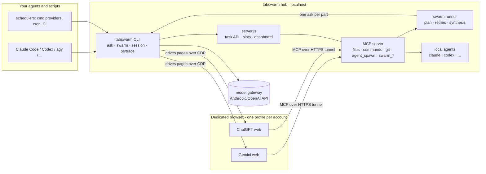

# tabswarm

**Drive real ChatGPT and Gemini web chats from your terminal and your agents, let them work on
your machine through MCP, and fan one job out over many chats and agents at once.**

tabswarm runs a small local hub. The hub has three parts:

* **A dedicated browser.** Pages are embedded in a small desktop app, or there is one isolated
  Chrome profile per account. Your everyday browser is never touched.
* **A local MCP server.** The web models use it to read and write files in folders you allow,
  run sandboxed commands, inspect git and start local coding agents.
* **One CLI and one skill.** Any agent (Claude Code, Codex, agy, other agent CLIs, scripts, schedulers) can
  ask a web model a question, keep a named conversation going, or start a **swarm**: a goal split
  into parallel parts with retries, fallbacks and one merged answer.

> ⚠️ **Read [Terms of service and risk](#terms-of-service-and-risk) before using this.**
> Automating the consumer web apps of ChatGPT and Gemini may violate their terms. tabswarm is
> meant for personal research on your own accounts.

## Features

* **`ask`, one stable entry point.** The prompt goes in on stdin, the answer comes out on
  stdout, and the exit code tells you what happened. Targets:
  * `web:gemini[:MODEL[:low|medium|high]]`: Gemini web with a picked model (e.g. Neon, Carbon,
    Hydrogen) and thinking level, both read back before sending;
  * `web:chatgpt[:MODEL[:EFFORT]]`: ChatGPT web, with a guard against spending Pro quota by
    accident;
  * `gateway[:MODEL]`: any Anthropic- or OpenAI-compatible HTTP endpoint;
  * local agents: `claude`, `codex`, or any CLI you add to the config.
* **Sessions.** `--session NAME` continues one conversation across calls. Web sessions count
  the MCP tool calls of their chat. Before the chat's budget runs out, the session moves to a
  fresh chat that starts with a handoff summary, so the work never hits the cap
  ([docs/limits.md](docs/limits.md)).
* **Swarms.** You give a plan, or a model writes one (`swarm plan --planner ...`). The parts
  run in parallel on mixed backends with a concurrency cap. Failed parts are retried on fallback
  targets, dependent parts get earlier answers, and a final synthesis merges everything. You can
  check live status, cancel, retry failed parts, or resume after a reboot.
* **Web models as coordinators.** Over MCP, a web chat can start local agents and other web
  chats (`agent_spawn`) or a whole swarm in one call (`swarm_start`). It waits for them with
  `wait_sec` instead of polling, so a web model can plan, hand out work, collect results and
  re-run failures.
* **Multi-account routing.** Each account has its own browser profile, concurrency slots, daily
  cap and rate-limit pause. Routing can be automatic failover, least-loaded `--account auto`, or
  pinned.
* **Observability.** A live dashboard (`http://127.0.0.1:8782/`) and `ps / top / watch / trace`
  show what each chat is doing, every MCP call with diffs, running commands and agents, and
  swarm progress.
* **Safety rails.** The server enforces allowed roots, deny globs for secret files, a
  `sandbox-exec` command sandbox, refused/confirmed command lists, git snapshots and trash copies
  before risky commands, OAuth plus a passcode on the public endpoint, and per-day caps.

## Architecture



* The **CLI process** drives the page for each web task (Playwright over CDP). It opens the
  chat, picks the connector, model and thinking level, sends the task card, clicks the site's own
  tool confirmations and waits for `report(final)`.
* The **web model** calls the hub's MCP tools through a public HTTPS URL (a Cloudflare tunnel
  by default). Every call carries the task id, so the hub knows which chat did what.
* A **swarm runner** is a detached process. Each attempt is its own detached `tabswarm ask`, so
  the runner and the hub can restart without losing work.

## Quick start

Requirements: macOS (the command sandbox uses `sandbox-exec`; the rest is portable Node),
Node.js ≥ 20, Google Chrome, [ripgrep](https://github.com/BurntSushi/ripgrep) (`rg`, used by the search tool), and a ChatGPT and/or Gemini account. For tool use you also need the
connector setup in step 4.

```bash
git clone https://github.com/<you>/tabswarm && cd tabswarm
npm ci
ln -s "$PWD/bin/webhub.mjs" ~/.local/bin/tabswarm     # or: npm link

# 1. configure the folders the models may use (~/.tabswarm/config.json)
mkdir -p ~/.tabswarm && cp examples/config.example.json ~/.tabswarm/config.json   # edit "roots"

# 2. run the hub (launchd on macOS; or `npm start` in a terminal)
tabswarm install          # server + tunnel + goal runner as LaunchAgents
tabswarm status && tabswarm url

# 3. sign in once, by hand, in the dedicated browser
tabswarm login gemini
tabswarm login chatgpt

# 4. add the MCP connector once in each web app, by hand:
#    Gemini: Settings → Connected apps → Custom → URL from `tabswarm url`, name "Local Projects"
#    ChatGPT: Settings → Connectors → custom MCP server, same URL
#    the passcode for the OAuth page is in `tabswarm secrets`

# 5. go
tabswarm ask --backend web:gemini --model Neon "What does this repo do?" --cwd ~/projects/foo
```

No browser? `ask` and swarms also work with only a gateway or local agents:

```bash
export TABSWARM_GATEWAY_URL=http://127.0.0.1:4000 TABSWARM_GATEWAY_KEY=...   # any Anthropic-compatible proxy
tabswarm ask --backend gateway:my-model "hello"
```

## Examples

```bash
# a second opinion from three models at once, merged
tabswarm swarm run --backend web:chatgpt,web:gemini:Neon,gateway:my-model \
  "Review docs/design.md for risks" "Review docs/design.md for missing tests" "Review docs/design.md for API problems"

# let Carbon plan an audit and run it on ChatGPT, Gemini and Codex
tabswarm swarm plan "Audit src/ for security issues and propose fixes" \
  --planner carbon --workers web:chatgpt,web:gemini:Neon,codex --cwd ~/projects/foo --run --wait

# keep a design conversation going across days
tabswarm ask --backend carbon --session cache-design "Here is the new constraint: ..."
tabswarm session list

# watch and control
tabswarm swarm status sw_1a2b3c4d --watch
tabswarm swarm cancel sw_1a2b3c4d
tabswarm trace t_9f8e7d6c          # every tool call the web chat made, with diffs
```

More: [examples/](examples/). These include a swarm plan, a coordinator prompt for a web model,
and agent backend recipes (agy locally or over SSH).

## Using it from other agents

Install the skill for your agent by copying or linking `skills/tabswarm/` into its skills
folder (e.g. `~/.claude/skills/`, `~/.codex/skills/`, `~/.agents/skills/`). The skill documents
the stable interface:

* `tabswarm ask`: stdin → stdout, exit codes 0/2/3/4/5;
* `tabswarm swarm start|status|result|cancel --json`;
* the HTTP equivalents on the admin port.

For using tabswarm as a backend of another scheduler (`cmd:`-style providers, queues), see
[docs/scheduler-backend.md](docs/scheduler-backend.md).

## CLI reference

```text
tabswarm ask [--backend SPEC] [--model M] [--effort E] [--session NAME | --chat URL]
             [--cwd DIR] [--account NAME|auto] [--timeout SEC] [--json] [-f FILE | -] "prompt"
tabswarm swarm plan "goal" [--planner SPEC] [--workers a,b,c] [--max-tasks N] [--run] [--wait]
tabswarm swarm start plan.json [--concurrency N] [--retries N] [--wait] [--json]
tabswarm swarm run [--backend a,b] [--fallback c] "prompt 1" "prompt 2" ...
tabswarm swarm list | status ID [--watch|--answers|--json] | result ID [--wait] | cancel ID | retry ID [TASK..] | resume ID
tabswarm session list | show NAME | rm NAME
tabswarm targets                       backends, gateways and aliases on this machine
tabswarm run --site gemini|chatgpt ... the original one-task dispatcher (prints answer + details)
tabswarm ps [--probe] [--json] | top | watch [ID] | trace ID | cancel ID | kill JOB|AGENT
tabswarm account list|add|remove|enable|disable|default    tabswarm login gemini|chatgpt
tabswarm browser up|down|show|status|tabs|open|focus|close|mode|import-login|login-external
tabswarm install|uninstall|start|stop|restart|status|url|secrets|logs
```

`webhub` is the same CLI under its older name.

## Configuration

Everything mutable lives in the state dir: `$WEBHUB_STATE_DIR`, else `~/.tabswarm`. An existing
`~/.gemini-web-mcp` from older versions is used as is. The state dir holds `config.json`,
`secrets.json` (generated, mode 0600), logs, tasks, sessions and swarms. Nothing in the state
dir belongs in git. See [examples/config.example.json](examples/config.example.json) for the
common keys:
`roots`, `accounts`, `agents`, `gateways`, `models` (aliases), `sessions`, `swarm`, `gemweb.*`.

## Terms of service and risk

* **Automating the consumer ChatGPT and Gemini web apps may violate the OpenAI and Google terms
  of use.** Both prohibit or restrict automated access, scraping and circumventing usage limits.
  Your account could be rate-limited, flagged or suspended. Use tabswarm only with your own
  accounts, at low volume, for **personal research**. Do not use it to resell access, to get
  around usage limits, or for anything commercial. If you need volume, use the official APIs (the
  `gateway` backend speaks them).
* tabswarm never signs in for you, never stores your password, and does not fake browser
  fingerprints or hide automation. You sign in by hand in a normal Chrome window, and it obeys
  rate-limit notices by pausing (`tabswarm limit`).
* The web models get **real tool access** to the folders you allow. The server-side rails (roots,
  deny globs, sandbox, refused commands, snapshots) are there because models make mistakes. Keep
  `roots` narrow, keep secrets out of them, and read `tabswarm trace` before trusting a summary.
* The MCP endpoint must be reachable from the web over HTTPS (a tunnel). It is protected by OAuth
  plus a local passcode. Treat `secrets.json` like a password.

This project is not affiliated with OpenAI or Google.

## Development

```bash
npm test            # all suites; they start their own hub on temp state dirs and fixed test ports
node scripts/swarm-test.mjs   # one suite
```

The tests never touch a live hub or a real account: web tasks use a mock driver, agents a fake
CLI and the gateway a fake HTTP server. See [CONTRIBUTING.md](CONTRIBUTING.md).

## License

[Apache-2.0](LICENSE)
